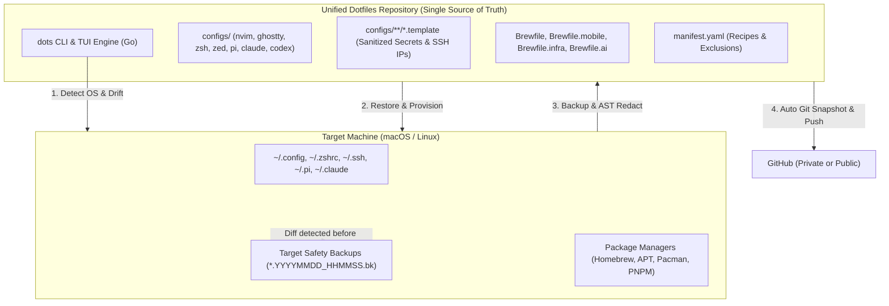

# dots ⚡️ (`kevnnard-dots`)

<div align="center">

[](https://go.dev/)
[](https://github.com/kevnnard/dots)
[](https://github.com/kevnnard/homebrew-tap)
[](LICENSE)

<br/>

```text
██╗  ██╗███████╗██╗   ██╗███╗   ██╗███╗   ██╗ █████╗ ██████╗ ██████╗ 
██║ ██╔╝██╔════╝██║   ██║████╗  ██║████╗  ██║██╔══██╗██╔══██╗██╔══██╗
█████╔╝ █████╗  ██║   ██║██╔██╗ ██║██╔██╗ ██║███████║██████╔╝██║  ██║
██╔═██╗ ██╔══╝  ╚██╗ ██╔╝██║╚██╗██║██║╚██╗██║██╔══██║██╔══██╗██║  ██║
██║  ██╗███████╗ ╚████╔╝ ██║ ╚████║██║ ╚████║██║  ██║██║  ██║██████╔╝
╚═╝  ╚═╝╚══════╝  ╚═══╝  ╚═╝  ╚═══╝╚═╝  ╚═══╝╚═╝  ╚═╝╚═╝  ╚═╝╚═════╝ 
                      DOTFILES & MACHINE PROVISIONER
```

**Cross-platform workstation setup, dotfiles backup engine, and AI agent harness in Go.**  
Zero dependencies on blank machines. Interactive 8-bit TUI dashboard. Enterprise-grade secret protection.

[⚡️ Quickstart](#️-60-second-quickstart) • [🗺️ Architecture](#️-system-architecture) • [🖥️ Interactive TUI](#️-interactive-tui-dashboard) • [📦 Stacks & Profiles](#-stacks--profiles-matrix) • [🛡️ Secrets](#️-zero-leak-secrets-engine) • [📖 CLI Guide](#-complete-cli-reference)

</div>

---

## ⚡️ 60-Second Quickstart

### Option A: One-line bootstrap (Zero dependencies)
Run this single command in any fresh terminal on macOS or Linux:

```bash
curl -fsSL https://raw.githubusercontent.com/kevnnard/dots/main/install.sh | bash
```
> **What this does:**
> 1. Detects OS (`Darwin` or `Linux`) and package managers (`brew`, `apt`, `pacman`, `dnf`, `pnpm`).
> 2. Clones the unified repository to `~/Repositories/dots` (or `~/.dotfiles`).
> 3. Installs standalone static binaries to `~/.local/bin/dots` and `~/.local/bin/kevnnard-dots`.
> 4. Launches the interactive Bubble Tea visual dashboard immediately.

### Option B: Homebrew Tap (macOS)
```bash
brew tap kevnnard/tap
brew install --HEAD kevnnard/tap/dots
```

### Option C: Build from source
```bash
git clone https://github.com/kevnnard/dots.git ~/Repositories/dots
cd ~/Repositories/dots
go build -ldflags="-s -w" -o ~/.local/bin/dots ./cmd/dots
```

---

## 👥 How to Use This Repository

| Mode | Who it's for | Workflow |
|:---|:---|:---|
| **1. Use My Setup (Consumer)** | You like this exact workstation setup (Ghostty, Neovim, Herdr, Zsh, AI agents) and want your Mac or Linux to look and work identically. | Just run the Quickstart and execute `dots restore --install-packages`. You don't need to fork; your machine simply downloads and installs the official recipes. |
| **2. Manage Your Own Dotfiles (Fork & Backup)** | You want to use `dots` as the engine to version and sync **your own personal** dotfiles across your own computers. | 1. Click **[Fork](https://github.com/kevnnard/dots/fork)** on GitHub to create `github.com/<your-username>/dots`.<br/>2. Clone your fork (`git clone https://github.com/<your-username>/dots.git ~/.dotfiles`).<br/>3. Run `dots backup` — snapshots and commits will push to **your own repository**, keeping your configs safe under your account! |

> 💡 **Tip for Fork users:** You can run the one-line installer pointing directly to your fork:
> ```bash
> curl -fsSL https://raw.githubusercontent.com/kevnnard/dots/main/install.sh | DOTS_REPO="https://github.com/<your-username>/dots.git" bash
> ```

---

## 🗺️ System Architecture

`dots` uses a **Single Source of Truth** model. Both the tool source code and the configuration files live in the same repository, safely deploying outwards to host OS destinations and collecting backups inward through an automated sanitization firewall:



---

## 🖥️ Interactive TUI Dashboard

Running `dots` (or `kevnnard-dots`) with no arguments launches the visual terminal dashboard:

```bash
dots
```

```text
 ─── KEVNNARD-DOTS · WORKSTATION & DOTFILES MANAGER ───────────────────
  System: darwin (arm64, brew)  ·  Status: 14 apps tracked

  Select Installation Mode:

  ❯ 🌟  Full Setup       (All Profiles: Core + Mobile + Infra + AI)
    ⚡️  Core Only        (Workstation default: Shell, Neovim, Ghostty, Brew, Web)
    🤖  AI & Agents      (Pi, Claude Code, Codex, and Ollama local runtime)
    📱  Mobile Dev       (React Native, OpenJDK 17, CocoaPods, Fastlane)
    🛠️   Custom Selection (Pick and choose individual apps with checkboxes)

  Navigate: ↑/↓ · Select: Enter · Back: Esc
```

### Keyboard Shortcuts

| Key | Action |
|:---:|:---|
| `↑` / `↓` or `k` / `j` | Navigate through options, presets, and apps |
| `Enter` | Select action, confirm installation preset, or view status |
| `Space` | Toggle individual application in Custom Selection |
| `a` | Toggle select all / unselect all in Custom Selection |
| `b` | Trigger immediate Backup from main menu |
| `r` | Trigger Restore wizard from main menu |
| `d` | Trigger Dry-run simulation (preview without writing) |
| `Esc` | Return to previous view |
| `q` or `Ctrl+C` | Quit |

---

## 📦 Stacks & Profiles Matrix

Configurations and software packages are grouped into modular profiles. You can install everything at once, or only the stack you need:

| Profile | Focus | Included Tools & Applications | Default State |
|:---|:---|:---|:---:|
| **`core`** | **Daily Driver & Web** | • **Shell**: Zsh, Powerlevel10k, Atuin history, Zoxide, FZF, Carapace, Tmux<br/>• **Editors & Terminal**: Neovim (LazyVim setup), Ghostty (custom shaders & themes), Herdr process manager, Zed, Git, LazyGit<br/>• **Dev Runtimes**: Go, FNM (Node), PNPM, Python UV, .NET 9 SDK, Docker Desktop<br/>• **Productivity**: Bruno (API Client), Bitwarden, DBeaver, SmartWindow, Nerd Fonts | **ON** |
| **`ai`** | **AI Coding Agents** | • **Harness**: Gentle AI (`gentle-ai`), Engram Persistent Memory (`engram`)<br/>• **Agents**: Pi Agent Harness (`~/.pi`), Claude Code CLI (`~/.claude`), Codex CLI (`~/.codex`), Orca integration hooks (`~/.orca`)<br/>• **Skills**: Full Gentleman agent skills catalog (`~/.agents/skills`)<br/>• **Local Models**: Ollama runtime (`ollama` cask / script) | **ON** *(Ollama optional)* |
| **`mobile`** | **Mobile Builds** | • OpenJDK 17 (`openjdk@17`)<br/>• CocoaPods (`cocoapods`)<br/>• Fastlane (`fastlane`) for React Native and native iOS/Android deployment | Optional |
| **`infra`** | **Cloud & Devops** | • Caddy web server with automatic HTTPS (`caddy`)<br/>• Local SSL certificates (`mkcert`)<br/>• Local GitHub Actions runner (`act`) | Optional |

---

## 🛡️ Zero-Leak Secrets Engine

`dots` was engineered to allow publishing dotfiles to **public GitHub repositories** without ever leaking tokens, keys, database passwords, or server addresses.

```text
Local Machine Config                       Dotfiles Repository (Public Safe)
────────────────────                       ─────────────────────────────────
~/.ssh/config (Host 165.232.145.129)  ──►  configs/ssh/config.template (Host YOUR_SERVER_HOST_OR_IP)
~/.pi/agent/mcp.json (Linear / GCP)   ──►  configs/pi/mcp.json.template (lin_api_*** -> YOUR_LINEAR_KEY)
~/.claude/mcp.json (Postgres URL)     ──►  configs/claude/mcp.json.template (postgres://... -> YOUR_POSTGRES_URL)
~/.env (API_KEY=sk-proj-12345)        ──►  configs/**/*.env.template (API_KEY=YOUR_API_KEY)
~/.ssh/id_ed25519                     ──►  ⛔️ BLOCKED by gitignore & engine exclusion filter
```

1. **AST-Level JSON Sanitization**: Detects and redacts Bearer tokens, OpenAI/Anthropic/Linear/GCP API keys, and connection strings while preserving JSON hierarchy and server arguments.
2. **SSH Config Anonymization**: Preserves connection options, aliases, and timeouts, while masking private IP addresses and user accounts.
3. **Template Preservation on Restore**: When running `restore`, existing local files are never overwritten with templates. New machines receive `.template` files as a clean scaffolding for credentials.
4. **Local Safety Backups**: If a local file has modified content before a restore, `dots` creates `<file>.<YYYYMMDD_HHMMSS>.bk` first. Zero data loss guaranteed.

---

## 📖 Complete CLI Reference

While the interactive TUI is the default, all features are exposed via deterministic CLI subcommands for scripts and headless servers:

```bash
# Launch interactive TUI
dots

# Detect OS, Architecture, and available package managers
dots detect

# Inspect synchronization state and file drift across apps
dots status

# Backup all apps and push Git snapshot to remote
dots backup

# Backup a specific app without pushing
dots backup nvim --push=false

# Dry-run restore simulation for default Core profile
dots restore --dry-run

# Restore and install packages for Core profile
dots restore --install-packages

# Restore and install AI & Agent stack (Pi, Claude, Codex, Ollama)
dots restore --profile ai --install-packages

# Restore Mobile stack (React Native / iOS / Android)
dots restore --profile mobile --install-packages

# Restore full environment (all profiles combined)
dots restore --all --install-packages

# Track and immediately backup a new configuration
dots add starship ~/.config/starship.toml
```

---

## ⚡️ Package Manager Hierarchy: `pnpm` First

For all Node.js and JavaScript tooling, `dots` enforces `pnpm` as the primary, first-class package manager:
- When a package recipe specifies `pnpm`, it executes `pnpm add -g <pkg>`.
- If a recipe specifies `npm`, the engine inspects the system with `HasManager(ManagerPnpm)` and automatically uses `pnpm add -g` if `pnpm` is present.
- Saves disk space via content-addressable storage and prevents package collision.

---

## 📂 Repository Layout

```text
dots/
├── cmd/dots/                # Go CLI entrypoint, subcommands, and TUI wiring
├── pkg/
│   ├── backup/              # Copy engine, exclusions, and secret AST sanitizers
│   ├── detector/            # OS, Distro, Arch, and package manager detector
│   ├── manifest/            # manifest.yaml parser, path expander, Brewfiles
│   ├── restore/             # File restoration, safety .bk creator, package runner
│   ├── status/              # Drift inspector and diff engine
│   └── ui/                  # Bubble Tea / Lipgloss terminal visual dashboard
├── configs/                 # Tracked dotfiles (deployed outwards to host)
│   ├── agents/skills/       # Full Gentleman AI skill catalog
│   ├── claude/              # Claude Code settings, agents, and mcp.json.template
│   ├── codex/               # Codex CLI rules, hooks, and config.toml
│   ├── engram/              # Engram memory protocol configuration
│   ├── gentle-ai/           # Gentle AI harness state and model assignments
│   ├── ghostty/             # Ghostty shaders, themes, and configuration
│   ├── herdr/               # Herdr terminal workspace and agent manager
│   ├── nvim/                # LazyVim setup, plugins, and keymaps
│   ├── orca/                # Orca agent workspace hooks
│   ├── pi/                  # Pi Agent harness, models, chains, mcp.json.template
│   ├── ssh/                 # Sanitized config.template (IPs masked)
│   ├── zed/                 # Zed editor keymaps and settings
│   └── zsh/                 # .zshrc and .p10k.zsh Powerlevel10k theme
├── Brewfile                 # Core macOS workstation packages
├── Brewfile.ai              # AI agents & Ollama local runtime
├── Brewfile.infra           # Local infrastructure & test tools
├── Brewfile.mobile          # React Native & mobile build dependencies
├── install.sh               # Zero-dependency bootstrap script for fresh machines
├── manifest.yaml            # Single source of truth application manifest
└── LICENSE                  # PolyForm Noncommercial 1.0.0
```

---

## 📜 License

This project is licensed under the **[PolyForm Noncommercial License 1.0.0](LICENSE)**.

- **✅ Free for personal use**: Anyone can use, modify, fork, and distribute this software for personal workstation setups, education, research, and non-commercial development.
- **❌ Commercial sale prohibited**: Selling, reselling, or commercial exploitation of this software or its derivatives is strictly prohibited without explicit written consent from the author.

Copyright (c) 2026 **Kevin Naranjo (Kevnnard)**.
