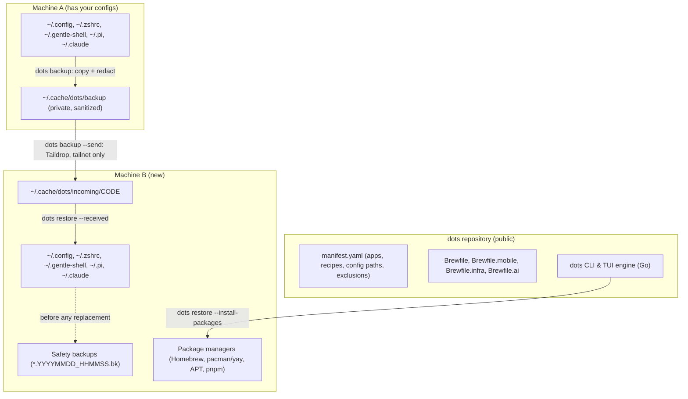

# dots ⚡️ (`kevnnard-dots`)

<div align="center">

[](https://go.dev/)
[](https://github.com/kevnnard/dots)
[](https://github.com/kevnnard/homebrew-tap)
[](LICENSE)

<br/>

```text
██╗  ██╗███████╗██╗   ██╗███╗   ██╗███╗   ██╗ █████╗ ██████╗ ██████╗ 
██║ ██╔╝██╔════╝██║   ██║████╗  ██║████╗  ██║██╔══██╗██╔══██╗██╔══██╗
█████╔╝ █████╗  ██║   ██║██╔██╗ ██║██╔██╗ ██║███████║██████╔╝██║  ██║
██╔═██╗ ██╔══╝  ╚██╗ ██╔╝██║╚██╗██║██║╚██╗██║██╔══██║██╔══██╗██║  ██║
██║  ██╗███████╗ ╚████╔╝ ██║ ╚████║██║ ╚████║██║  ██║██║  ██║██████╔╝
╚═╝  ╚═╝╚══════╝  ╚═══╝  ╚═╝  ╚═══╝╚═╝  ╚═══╝╚═╝  ╚═╝╚═╝  ╚═╝╚═════╝ 
                      DOTFILES & MACHINE PROVISIONER
```

**Cross-platform workstation setup, dotfiles backup engine, and AI agent harness in Go.**  
Zero dependencies on blank machines. Interactive 8-bit TUI dashboard. Enterprise-grade secret protection.

[⚡️ Quickstart](#️-60-second-quickstart) • [🚚 New machine](#-new-machine-step-by-step) • [🧹 Clean up](#-clean-up) • [🗺️ Architecture](#️-system-architecture) • [🖥️ Interactive TUI](#️-interactive-tui-dashboard) • [📦 Stacks & Profiles](#-stacks--profiles-matrix) • [🛡️ Secrets](#️-secrets-handling) • [📖 CLI Guide](#-complete-cli-reference)

</div>

---

## ⚡️ 60-Second Quickstart

### Option A: One-line bootstrap (Zero dependencies)
Run this single command in any fresh terminal on macOS or Linux (Windows: use WSL):

```bash
curl -fsSL https://raw.githubusercontent.com/kevnnard/dots/main/install.sh | bash
```
> **What this does:**
> 1. Detects the OS and installs missing `git`/`curl` with the native package manager (`pacman`, `apt`, `dnf`, `zypper`, `apk`, `brew`).
> 2. Clones the unified repository to `~/Repositories/dots` (or `~/.dotfiles`).
> 3. Downloads the official Go toolchain to `~/.local/go` if Go is missing or older than 1.21, then builds `~/.local/bin/dots` and `~/.local/bin/kevnnard-dots`.
> 4. Launches the interactive Bubble Tea visual dashboard (set `DOTS_NO_LAUNCH=1` to skip).

### Option B: Homebrew (macOS and Linux)
```bash
brew tap kevnnard/tap
brew install kevnnard/tap/dots        # latest stable release
brew upgrade kevnnard/tap/dots        # after a new release
brew install --HEAD kevnnard/tap/dots # latest main, for unreleased changes
```
The formula installs `dots` and the alias `kevnnard-dots`. Each release is cut with `scripts/release.sh` (see [Releases](#-releases)).

### Option C: Build from source
```bash
git clone https://github.com/kevnnard/dots.git ~/Repositories/dots
cd ~/Repositories/dots
go build -ldflags="-s -w" -o ~/.local/bin/dots ./cmd/dots
```

---

## 👥 How to Use dots

This repository holds the **tool and its install recipes**, not your configs. You never fork it or push your dotfiles to it: install `dots`, restore with it, and move your own configs between your machines as a private backup over Tailscale.

| Goal | What you run |
|:---|:---|
| **Set up a machine with these tools** | Install `dots` (Quickstart), then `dots restore --all --install-packages` and `dots setup`. Apps keep their stock configuration. |
| **Bring your configs from another machine** | On the machine that has them: `dots backup` and `dots backup --send <device>`. On the new one: `dots backup --receive <code>`, then `dots restore --received --all`. See [New machine, step by step](#-new-machine-step-by-step). |
| **Track one more config** | `dots add <app> <path>`: records it in the manifest and stages it in your private backup; it travels with your next `dots backup --send`. |

What a backup covers (and what it never copies) is listed in [docs/portable-config-backup.md](docs/portable-config-backup.md).

---

## 🗺️ System Architecture

The repository is the **source of truth for what to install and where configs live** (`manifest.yaml`, Brewfiles, the Go engine). Your configs never go into it: `dots backup` copies them, sanitized, into a private staging folder, and Taildrop moves that archive to your other machines inside your tailnet.



---

## 🖥️ Interactive TUI Dashboard

Running `dots` (or `kevnnard-dots`) with no arguments launches the visual terminal dashboard:

```bash
dots
```

```text
 ─── KEVNNARD-DOTS · WORKSTATION & DOTFILES MANAGER ───────────────────
  System: darwin (arm64, brew)  ·  Status: 14 apps tracked

  Select Installation Mode:

  ❯ 🌟  Full Setup       (All Profiles: Core + Mobile + Infra + AI; optional apps via Custom)
    ⚡️  Core Only        (Workstation default: Shell, Neovim, Ghostty, Brew, Web)
    🤖  AI & Agents      (Pi, Claude Code, Codex, and Ollama local runtime)
    📱  Mobile Dev       (React Native, OpenJDK 17, CocoaPods, Fastlane)
    🛠️   Custom Selection (Pick and choose individual apps with checkboxes)

  [c] Restore backed-up configs: off — apps keep their stock configuration; local files are untouched

  Navigate: ↑/↓ · Select: Enter · Configs: c · Replace local files: r · Back: Esc
```

Installing suspends the dashboard: install commands get the real terminal, so their output and `sudo` prompts show up normally, and the dashboard returns with the run summary when they finish.

### Keyboard Shortcuts

| Key | Action |
|:---:|:---|
| `↑` / `↓` or `k` / `j` | Navigate through options, presets, and apps |
| `Enter` | Select action, confirm installation preset, or view status |
| `Space` | Toggle individual application in Custom Selection |
| `a` | Toggle select all / unselect all in Custom Selection |
| `c` | On the installation mode screen: toggle deploying configs from the dotfiles directory (off by default). For a backup received from another machine use `dots restore --received`. |
| `r` | On the installation mode screen, with `c` on: allow replacing differing local files after a `.bk` safety backup |
| `b` | Trigger immediate Backup from main menu |
| `d` | Trigger Dry-run simulation (preview without writing) |
| `Esc` | Return to previous view |
| `q` or `Ctrl+C` | Quit |

---

## 📦 Stacks & Profiles Matrix

Configurations and software packages are grouped into modular profiles. You can install everything at once, or only the stack you need:

| Profile | Focus | Included Tools & Applications | Default State |
|:---|:---|:---|:---:|
| **`core`** | **Daily Driver & Web** | • **Shell**: Zsh, Powerlevel10k, Atuin history, Zoxide, FZF, Carapace, Tmux<br/>• **Editors & Terminal**: Neovim (LazyVim setup), Ghostty (custom shaders & themes), Herdr process manager, Zed, Git, LazyGit<br/>• **Dev Runtimes**: Go, FNM (Node), PNPM, Python UV, .NET 9 SDK, Docker Desktop<br/>• **Productivity & Network**: Bruno (API Client), DBeaver (SQL), Tailscale (VPN Mesh), Bitwarden, SmartWindow, Nerd Fonts *(Optional: Postman, MongoDB Compass)* | **ON** |
| **`ai`** | **AI Coding Agents** | • **Harness**: Gentle AI (`gentle-ai`), Engram Persistent Memory (`engram`)<br/>• **Agents**: Gentle Shell agent home (`~/.gentle-shell/agent`, same path on macOS and Linux; login files never travel, sign in with `/login`), Pi Agent Harness (`~/.pi`), Claude Code CLI (`~/.claude`), Codex CLI (`~/.codex`)<br/>• **Skills**: Full Gentleman agent skills catalog (`~/.agents/skills`)<br/>• **Local Models**: Ollama runtime (`ollama` cask / script) | **ON** *(Ollama optional)* |
| **`mobile`** | **Mobile Builds** | • OpenJDK 17 (`openjdk@17`)<br/>• CocoaPods (`cocoapods`)<br/>• Fastlane (`fastlane`) for React Native and native iOS/Android deployment | Optional |
| **`infra`** | **Cloud & Devops** | • Caddy web server with automatic HTTPS (`caddy`)<br/>• Local SSL certificates (`mkcert`)<br/>• Local GitHub Actions runner (`act`) | Optional |

---

## 🛡️ Secrets Handling

Backups never go to GitHub. They stay in a private folder and travel only over your tailnet. In files the manifest names as secrets (and in `.env`, `*.key`, `*.pem` files), values under credential-like keys, such as tokens, keys, database passwords and server addresses, become placeholders in templates. Login files are not mapped at all.

Detection goes by file name and key name. It cannot prove that other scripts, settings or extensions are free of credentials, so **review the staged folder before you send it**. If a staging folder written by an earlier dots holds an unmasked copy where a template now belongs, backup stops and removes nothing; stage into a new empty folder with `dots backup --out <new-folder>`. Coverage and limits: [docs/portable-config-backup.md](docs/portable-config-backup.md).

```text
Local Machine Config                       Private backup (~/.cache/dots/backup)
────────────────────                       ─────────────────────────────────────
~/.ssh/config (Host 165.232.145.129)  ──►  configs/ssh/config.template (Host YOUR_SERVER_HOST_OR_IP)
~/.pi/agent/mcp.json (Linear / GCP)   ──►  configs/pi/mcp.json.template (lin_api_*** -> YOUR_LINEAR_KEY)
~/.claude/mcp.json (Postgres URL)     ──►  configs/claude/mcp.json.template (postgres://... -> YOUR_POSTGRES_URL)
~/.env (API_KEY=sk-proj-12345)        ──►  configs/**/*.env.template (API_KEY=YOUR_API_KEY)
~/.pi/web-search.json (API keys)      ──►  configs/pi/web-search.json.template (keys masked)
~/.pi/agent/auth.json, mcp-auth.json  ──►  ⛔️ never copied (log in again on the new machine)
~/.ssh/id_ed25519                     ──►  ⛔️ never copied (engine exclusion filter)
```

1. **AST-Level JSON Sanitization**: Detects and redacts Bearer tokens, OpenAI/Anthropic/Linear/GCP API keys, and connection strings while preserving JSON hierarchy and server arguments.
2. **SSH Config Anonymization**: Preserves connection options, aliases, and timeouts, while masking private IP addresses and user accounts.
3. **Template Preservation on Restore**: When running `restore`, existing local files are never overwritten with templates. New machines receive `.template` files as a clean scaffolding for credentials.
4. **Local Files Are Kept**: `restore --with-config` keeps local files whose content differs from the backup and lists them. Only `--replace-existing` (TUI: `r`) replaces them, and each replacement happens only after `<file>.<YYYYMMDD_HHMMSS>.bk` was written successfully. Machine-specific files marked `keep_local: true` in the manifest (`~/.gitconfig`, which holds the git signing key, and the Pi and Gentle Shell `subagents.json`) are never replaced: restore deploys them only where they are missing and lists them as `kept machine-specific file`.
5. **Readiness Report, Names Only**: every restore (CLI and TUI) ends with a per-app list of what is still missing: placeholder fields and unset environment variables by name, file and field (`env GH_MCP_TOKEN (mcpServers.github.env.GITHUB_TOKEN in ~/.pi/agent/mcp.json) → export GH_MCP_TOKEN=…`), pending logins (`codex login`, `/login` in `pi`) and missing MCP commands. Values are never printed, and nothing is validated online: what dots cannot prove is marked `not-verified` with the command to check it. See [docs/install-flow.md](docs/install-flow.md#readiness-report).

---

## 📖 Complete CLI Reference

While the interactive TUI is the default, all features are exposed via deterministic CLI subcommands for scripts and headless servers:

```bash
# Launch interactive TUI
dots

# Detect OS, Architecture, and available package managers
dots detect

# Inspect synchronization state and file drift across apps
dots status

# Stage a backup of all apps in ~/.cache/dots/backup (never in the repo, never pushed).
# A manifest from an older dots is not rewritten: backup lists the built-in paths it lacks.
# It also lists undeclared Homebrew packages and ~/.config entries under "New:" (with the
# systems each works on) and adds them to the staged manifest only; credential and cache
# folders are listed under "Skipped:". With engram installed, it exports Engram memories.
dots backup

# Stage a single app
dots backup nvim

# Move a backup between your machines over Taildrop (tailnet only, no public server).
# Sender: run `dots backup` first, then send the staged archive to a device name.
dots backup --send kevnnard-station
# Receiver: take the archive from the Taildrop inbox; it must match the code the sender printed.
dots backup --receive <code>

# Restore the last received backup: review first, then apply (see "New machine, step by step")
dots restore --received --all --dry-run

# Dry-run restore simulation for default Core profile (no clone, writes or commands)
dots restore --dry-run

# Install Core packages with their stock configuration
dots restore --install-packages

# Install packages and deploy the configs of the last received backup
dots restore --received --all --install-packages

# Same, also replacing differing local files (each gets a .bk safety backup first)
dots restore --received --all --install-packages --replace-existing

# Deploy configs from a backup folder you extracted yourself
dots -d ~/.cache/dots/incoming/<code> restore --with-config

# Install one app with the apps it requires (optional apps must be named)
dots restore lazygit --install-packages

# Restore and install AI & Agent stack (Pi, Claude, Codex, Ollama)
dots restore --profile ai --install-packages

# Restore Mobile stack (React Native / iOS / Android)
dots restore --profile mobile --install-packages

# Restore full environment (all profiles combined)
dots restore --all --install-packages

# Guided post-install steps (shell, logins, next actions); resumable
dots setup
dots setup --dry-run
# Setup never runs a login or an installer for you: the Gentle Shell install and
# login, Codex, Antigravity, Linear, Neon (API key) and Postgres steps show what
# to do in your own terminal, then check the tool's status when it can.
# See docs/setup.md#guided-steps.

# Preview the cleanup of every declared app: packages and configs (changes nothing)
dots clean --all --packages --configs --dry-run

# Clean one app after one confirmation; its configs move to quarantine, never deleted
dots clean zsh --configs

# Move older restore backups (*.bk) to quarantine; the newest of each file stays
dots clean --backups --dry-run

# Undo a clean: put the quarantined configs back (asks once)
dots clean recover ~/.dots-quarantine/clean-<timestamp>

# Track a new configuration path and stage it in the private backup folder
dots add starship ~/.config/starship.toml
```

---


## 🚚 New machine, step by step

Both machines need Tailscale, signed in to the same tailnet. Device names come from `tailscale status`.

**On the machine that has your configs (for example your Mac):**

```bash
brew upgrade kevnnard/tap/dots          # same dots version on both machines
dots backup                             # stage a sanitized copy in ~/.cache/dots/backup
dots backup --send <device>             # send it over Taildrop; prints an 8-character code
```

**On the new machine (for example Linux):**

```bash
# 1. Install dots (or use the one-line bootstrap from the Quickstart)
brew tap kevnnard/tap && brew install kevnnard/tap/dots

# 2. Let your user read the Taildrop inbox (once)
sudo "$(command -v tailscale)" set --operator=$USER

# 3. Receive the backup with the code the sender printed
dots backup --receive <code>

# 4. Preview, then install packages and deploy your configs
dots restore --received --all --install-packages --dry-run
dots restore --received --all --install-packages

# 5. Logins, API keys and the Gentle Shell install, in order
dots setup --dry-run
dots setup
```

What to expect:

1. **The code** is the start of the archive sha256 and is not stored anywhere: copy it from the sender output. A wrong code extracts nothing. The full sha256 also works with `--sha256 <sha256>`.
2. **Several backups in the inbox** are fine: copies of the matching one are dropped and any other backup is kept in `~/.cache/dots/incoming/unclaimed/`, never lost.
3. **Skills shared through `~/.agents/skills`** travel as relative symlinks; restore refuses any link that points outside home.
4. **Local files are kept** when they differ from the backup, and the summary lists them. Add `--replace-existing` only after reviewing the dry run; every replaced file first gets a `.bk` copy.
5. **Logins do not travel**: login files (`auth.json`, `mcp-auth.json`) are not mapped and `mcp.json` arrives as a template. Sign in again (Gentle Shell, Pi, Claude, Codex, Linear, Neon API key, Postgres); `dots setup` and the restore summary list each one.
6. **Gentle Shell**: install the bundled Gentle Shell with its own installer (`dots setup` shows where), then `dots restore gentle-shell --received`.

Known pitfalls of a macOS-to-Linux move (pnpm path, Gentle Shell installs, the Engram MCP server inside Gentle Shell, Neon sign-in) are listed in [docs/install-flow.md](docs/install-flow.md#moving-to-another-machine-known-pitfalls).

## 🧹 Clean up

`dots clean` undoes what `dots restore` installed or deployed, only for apps declared in `manifest.yaml`. It prints the whole plan first and changes nothing until you type `yes` once; `--dry-run` stops after the plan. It needs an interactive terminal, and there is no flag to skip the confirmation.

Pick what to clean; the three scopes are independent, and with none of them nothing is planned:

| Flag | What it does |
|:---|:---|
| `--packages` | Uninstalls the apps' packages with the manager's plain uninstall (no force, purge or recursion), dependents first. Only packages whose single declared owner the package database proves; others are reported as blocked or unsupported and never touched. |
| `--configs` | Moves the apps' mapped config files into `~/.dots-quarantine/clean-<timestamp>/`. Nothing is deleted; files that may hold credentials stay in place. Directories are not supported yet. |
| `--backups` | Moves older restore backups (`<file>.<timestamp>.bk`) into the same quarantine. The most recent backup of every file always stays. |

```bash
# Preview everything for every declared app (changes nothing)
dots clean --all --packages --configs --backups --dry-run

# Clean named apps only
dots clean zsh --configs
dots clean herdr fzf --packages

# Tidy up the .bk copies that restores leave behind
dots clean --backups --dry-run
dots clean --backups

# Undo: put a quarantine back (existing files are left as conflicts)
dots clean recover ~/.dots-quarantine/clean-<timestamp> --dry-run
dots clean recover ~/.dots-quarantine/clean-<timestamp>
```

`--all` means every app in the manifest, optional ones included; it never means every package installed on the machine. In the TUI, **Clean Up Apps** runs the same plan, with `p`, `c` and `b` toggling the scopes. Details: [docs/cleaner.md](docs/cleaner.md).

## 🌍 Cross-Platform Install Recipes

`dots` never assumes a specific machine. It detects the OS, the distro family (via `ID` and `ID_LIKE`, so derivatives such as Omarchy, CachyOS, Mint or Nobara map to their parent) and the native package manager (`yay`/`pacman`, `apt`, `dnf`, `zypper`, `brew`, `winget`, `scoop`, `choco`).

Each app in `manifest.yaml` can declare several recipes under `install:`. The first matching key wins:

| Order | Key | Example |
|-------|-----|---------|
| 1 | Exact distro | `arch`, `ubuntu`, `fedora` |
| 2 | Primary package manager, then any other available manager | `yay`, `pacman`, `apt`, `brew`, `winget` |
| 3 | Operating system | `darwin`, `linux`, `windows` |
| 4 | Any system | `default` |

Native managers therefore win over generic `curl | sh` scripts. Use `manager: script` with a `command` for tools that only ship an installer, and `requires: [node]` to install dependencies first.

```yaml
nvim:
  install:
    pacman:  { manager: pacman, package: neovim }
    apt:     { manager: apt,    package: neovim }
    winget:  { manager: winget, package: Neovim.Neovim }
    brew:    { manager: brew,   package: neovim }
pi:
  requires: [node]
  install:
    default: { manager: npm, package: "@earendil-works/pi-coding-agent" }
```

### Systems an app or path works on

An app or a path mapping may declare `os:` with a subset of `darwin`, `linux`, `windows`. A path may also declare `src_os:`, the source to use on a given system. Without `os:` an entry applies everywhere, so older manifests load unchanged; an unknown system name is a load error.

```yaml
smartwindow:
  os: [darwin]                     # a cask: macOS only
  install:
    darwin: { manager: brew, cask: kevnnard/tap/smartwindow }
mytool:
  paths:
    - src: ~/Library/Application Support/mytool
      dest: configs/mytool
      src_os:
        linux: ~/.config/mytool
        windows: ~/AppData/Roaming/mytool
```

| Field | On | Effect |
|:---|:---|:---|
| `os` | app | `restore` skips the app on other systems and reports it as `not for <system>`, not as a failure. `status` and `backup` ignore it there. |
| `os` | path | The same, for one mapping. |
| `src_os` | path | Per-system source: on a listed system, backup reads from and restore deploys to that source instead of `src`. `dest` is unchanged. |

A full `dots backup` writes these fields itself for what it discovers: casks and formulae with only macOS bottles or a macOS requirement get `os: [darwin]`; formulae with Linux bottles or built from source (such as Go tools from a personal tap), taps and `~/.config` entries get `os: [darwin, linux]`. They go into the staged manifest, never into the repository.

### Portable home paths
Absolute home directories are never versioned. `dots backup` stores them as `__HOME__` and `dots restore` expands them for the target machine, so `/Users/you/...` on macOS, `/home/you/...` on Linux and `C:/Users/you/...` on Windows all share the same config. `npm` global recipes install under `~/.local` to avoid `sudo`.

---

## ⚡️ Package Manager Hierarchy: `pnpm` First

For all Node.js and JavaScript tooling, `dots` enforces `pnpm` as the primary, first-class package manager:
- When a package recipe specifies `pnpm`, it executes `pnpm add -g <pkg>`.
- If a recipe specifies `npm`, the engine inspects the system with `HasManager(ManagerPnpm)` and automatically uses `pnpm add -g` if `pnpm` is present.
- Saves disk space via content-addressable storage and prevents package collision.

---

## 📂 Repository Layout

```text
dots/
├── cmd/dots/                # Go CLI entrypoint, subcommands, and TUI wiring
├── pkg/
│   ├── backup/              # Copy engine, exclusions, and secret AST sanitizers
│   ├── clean/               # Cleaner: packages, configs to quarantine, old .bk backups
│   ├── detector/            # OS, Distro, Arch, and package manager detector
│   ├── homepath/            # __HOME__ portable path mapping
│   ├── manifest/            # manifest.yaml parser, path expander, Brewfiles
│   ├── restore/             # File restoration, safety .bk creator, package runner
│   ├── setup/               # Resumable post-install steps (shell, logins, next actions)
│   ├── status/              # Drift inspector and diff engine
│   └── ui/                  # Bubble Tea / Lipgloss terminal visual dashboard
├── configs/                 # A few sanitized templates and defaults only; your configs travel in private backups
├── docs/                    # Setup, cleaner, and install-flow guides
├── scripts/release.sh       # Cut a release: tests, tag, GitHub release, Homebrew tap
├── Brewfile                 # Core macOS workstation packages
├── Brewfile.ai              # AI agents & Ollama local runtime
├── Brewfile.infra           # Local infrastructure & test tools
├── Brewfile.mobile          # React Native & mobile build dependencies
├── install.sh               # Zero-dependency bootstrap script for fresh machines
├── manifest.yaml            # Single source of truth application manifest
└── LICENSE                  # PolyForm Noncommercial 1.0.0
```

---

## 🚀 Releases

Releases are cut from `main` with a clean tree and `gh` authenticated:

```bash
scripts/release.sh --dry-run 1.3.0   # prints every step, changes nothing
scripts/release.sh 1.3.0
```

The script runs the tests, sets `version` in `cmd/dots/main.go`, commits, tags `v1.3.0` and pushes both. It creates the GitHub release and hashes the source tarball that Homebrew downloads. Then it updates `Formula/dots.rb` and `Formula/kevnnard-dots.rb` in the tap checkout (`TAP_DIR`, default `../homebrew-tap`) and pushes the tap. Users then run `brew upgrade kevnnard/tap/dots`.

---

## 📜 License

This project is licensed under the **[PolyForm Noncommercial License 1.0.0](LICENSE)**.

- **✅ Free for personal use**: Anyone can use, modify, fork, and distribute this software for personal workstation setups, education, research, and non-commercial development.
- **❌ Commercial sale prohibited**: Selling, reselling, or commercial exploitation of this software or its derivatives is strictly prohibited without explicit written consent from the author.

Copyright (c) 2026 **Kevnnard**.
