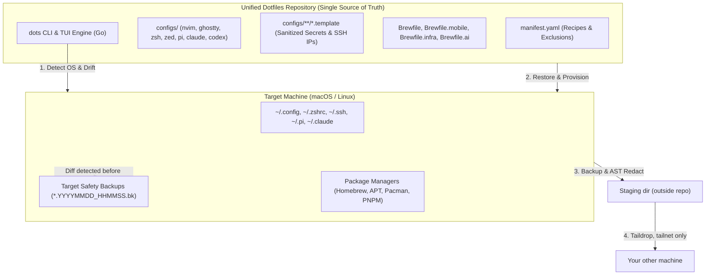

# dots ⚡️ (`kevnnard-dots`)

<div align="center">

[](https://go.dev/)
[](https://github.com/kevnnard/dots)
[](https://github.com/kevnnard/homebrew-tap)
[](LICENSE)

<br/>

```text
██╗  ██╗███████╗██╗   ██╗███╗   ██╗███╗   ██╗ █████╗ ██████╗ ██████╗ 
██║ ██╔╝██╔════╝██║   ██║████╗  ██║████╗  ██║██╔══██╗██╔══██╗██╔══██╗
█████╔╝ █████╗  ██║   ██║██╔██╗ ██║██╔██╗ ██║███████║██████╔╝██║  ██║
██╔═██╗ ██╔══╝  ╚██╗ ██╔╝██║╚██╗██║██║╚██╗██║██╔══██║██╔══██╗██║  ██║
██║  ██╗███████╗ ╚████╔╝ ██║ ╚████║██║ ╚████║██║  ██║██║  ██║██████╔╝
╚═╝  ╚═╝╚══════╝  ╚═══╝  ╚═╝  ╚═══╝╚═╝  ╚═══╝╚═╝  ╚═╝╚═╝  ╚═╝╚═════╝ 
                      DOTFILES & MACHINE PROVISIONER
```

**Cross-platform workstation setup, dotfiles backup engine, and AI agent harness in Go.**  
Zero dependencies on blank machines. Interactive 8-bit TUI dashboard. Enterprise-grade secret protection.

[⚡️ Quickstart](#️-60-second-quickstart) • [🗺️ Architecture](#️-system-architecture) • [🖥️ Interactive TUI](#️-interactive-tui-dashboard) • [📦 Stacks & Profiles](#-stacks--profiles-matrix) • [🛡️ Secrets](#️-zero-leak-secrets-engine) • [📖 CLI Guide](#-complete-cli-reference)

</div>

---

## ⚡️ 60-Second Quickstart

### Option A: One-line bootstrap (Zero dependencies)
Run this single command in any fresh terminal on macOS or Linux (Windows: use WSL):

```bash
curl -fsSL https://raw.githubusercontent.com/kevnnard/dots/main/install.sh | bash
```
> **What this does:**
> 1. Detects the OS and installs missing `git`/`curl` with the native package manager (`pacman`, `apt`, `dnf`, `zypper`, `apk`, `brew`).
> 2. Clones the unified repository to `~/Repositories/dots` (or `~/.dotfiles`).
> 3. Downloads the official Go toolchain to `~/.local/go` if Go is missing or older than 1.21, then builds `~/.local/bin/dots` and `~/.local/bin/kevnnard-dots`.
> 4. Launches the interactive Bubble Tea visual dashboard (set `DOTS_NO_LAUNCH=1` to skip).

### Option B: Homebrew (macOS and Linux)
```bash
brew tap kevnnard/tap
brew install kevnnard/tap/dots        # latest stable release
brew upgrade kevnnard/tap/dots        # after a new release
brew install --HEAD kevnnard/tap/dots # latest main, for unreleased changes
```
The formula installs `dots` and the alias `kevnnard-dots`. Each release is cut with `scripts/release.sh` (see [Releases](#-releases)).

### Option C: Build from source
```bash
git clone https://github.com/kevnnard/dots.git ~/Repositories/dots
cd ~/Repositories/dots
go build -ldflags="-s -w" -o ~/.local/bin/dots ./cmd/dots
```

---

## 👥 How to Use This Repository

| Mode | Who it's for | Workflow |
|:---|:---|:---|
| **1. Use My Setup (Consumer)** | You like this exact workstation setup (Ghostty, Neovim, Herdr, Zsh, AI agents) and want your Mac or Linux to look and work identically. | Just run the Quickstart and execute `dots restore --install-packages`. You don't need to fork; your machine simply downloads and installs the official recipes. |
| **2. Manage Your Own Dotfiles (Fork & Backup)** | You want to use `dots` as the engine to version and sync **your own personal** dotfiles across your own computers. | 1. Click **[Fork](https://github.com/kevnnard/dots/fork)** on GitHub to create `github.com/<your-username>/dots`.<br/>2. Clone your fork (`git clone https://github.com/<your-username>/dots.git ~/.dotfiles`).<br/>3. Run `dots backup` — it stages your configs in `~/.cache/dots/backup`, outside the repo. Nothing is committed or pushed; move the archive with Taildrop (see below). |

> 💡 **Tip for Fork users:** You can run the one-line installer pointing directly to your fork:
> ```bash
> curl -fsSL https://raw.githubusercontent.com/kevnnard/dots/main/install.sh | DOTS_REPO="https://github.com/<your-username>/dots.git" bash
> ```

---

## 🗺️ System Architecture

`dots` uses a **Single Source of Truth** model. Both the tool source code and the configuration files live in the same repository, safely deploying outwards to host OS destinations and collecting backups inward through an automated sanitization firewall:



---

## 🖥️ Interactive TUI Dashboard

Running `dots` (or `kevnnard-dots`) with no arguments launches the visual terminal dashboard:

```bash
dots
```

```text
 ─── KEVNNARD-DOTS · WORKSTATION & DOTFILES MANAGER ───────────────────
  System: darwin (arm64, brew)  ·  Status: 14 apps tracked

  Select Installation Mode:

  ❯ 🌟  Full Setup       (All Profiles: Core + Mobile + Infra + AI; optional apps via Custom)
    ⚡️  Core Only        (Workstation default: Shell, Neovim, Ghostty, Brew, Web)
    🤖  AI & Agents      (Pi, Claude Code, Codex, and Ollama local runtime)
    📱  Mobile Dev       (React Native, OpenJDK 17, CocoaPods, Fastlane)
    🛠️   Custom Selection (Pick and choose individual apps with checkboxes)

  [c] Restore backed-up configs: off — apps keep their stock configuration; local files are untouched

  Navigate: ↑/↓ · Select: Enter · Configs: c · Replace local files: r · Back: Esc
```

Installing suspends the dashboard: install commands get the real terminal, so their output and `sudo` prompts show up normally, and the dashboard returns with the run summary when they finish.

### Keyboard Shortcuts

| Key | Action |
|:---:|:---|
| `↑` / `↓` or `k` / `j` | Navigate through options, presets, and apps |
| `Enter` | Select action, confirm installation preset, or view status |
| `Space` | Toggle individual application in Custom Selection |
| `a` | Toggle select all / unselect all in Custom Selection |
| `c` | On the installation mode screen: toggle restoring the configs backed up in the repository (off by default) |
| `r` | On the installation mode screen, with `c` on: allow replacing differing local files after a `.bk` safety backup |
| `b` | Trigger immediate Backup from main menu |
| `d` | Trigger Dry-run simulation (preview without writing) |
| `Esc` | Return to previous view |
| `q` or `Ctrl+C` | Quit |

---

## 📦 Stacks & Profiles Matrix

Configurations and software packages are grouped into modular profiles. You can install everything at once, or only the stack you need:

| Profile | Focus | Included Tools & Applications | Default State |
|:---|:---|:---|:---:|
| **`core`** | **Daily Driver & Web** | • **Shell**: Zsh, Powerlevel10k, Atuin history, Zoxide, FZF, Carapace, Tmux<br/>• **Editors & Terminal**: Neovim (LazyVim setup), Ghostty (custom shaders & themes), Herdr process manager, Zed, Git, LazyGit<br/>• **Dev Runtimes**: Go, FNM (Node), PNPM, Python UV, .NET 9 SDK, Docker Desktop<br/>• **Productivity & Network**: Bruno (API Client), DBeaver (SQL), Tailscale (VPN Mesh), Bitwarden, SmartWindow, Nerd Fonts *(Optional: Postman, MongoDB Compass)* | **ON** |
| **`ai`** | **AI Coding Agents** | • **Harness**: Gentle AI (`gentle-ai`), Engram Persistent Memory (`engram`)<br/>• **Agents**: Gentle Shell agent home (`~/.gentle-shell/agent`, same path on macOS and Linux; login files never travel, sign in with `/login`), Pi Agent Harness (`~/.pi`), Claude Code CLI (`~/.claude`), Codex CLI (`~/.codex`), Orca integration hooks (`~/.orca`)<br/>• **Skills**: Full Gentleman agent skills catalog (`~/.agents/skills`)<br/>• **Local Models**: Ollama runtime (`ollama` cask / script) | **ON** *(Ollama optional)* |
| **`mobile`** | **Mobile Builds** | • OpenJDK 17 (`openjdk@17`)<br/>• CocoaPods (`cocoapods`)<br/>• Fastlane (`fastlane`) for React Native and native iOS/Android deployment | Optional |
| **`infra`** | **Cloud & Devops** | • Caddy web server with automatic HTTPS (`caddy`)<br/>• Local SSL certificates (`mkcert`)<br/>• Local GitHub Actions runner (`act`) | Optional |

---

## 🛡️ Zero-Leak Secrets Engine

`dots` was engineered to allow publishing dotfiles to **public GitHub repositories** without ever leaking tokens, keys, database passwords, or server addresses.

```text
Local Machine Config                       Dotfiles Repository (Public Safe)
────────────────────                       ─────────────────────────────────
~/.ssh/config (Host 165.232.145.129)  ──►  configs/ssh/config.template (Host YOUR_SERVER_HOST_OR_IP)
~/.pi/agent/mcp.json (Linear / GCP)   ──►  configs/pi/mcp.json.template (lin_api_*** -> YOUR_LINEAR_KEY)
~/.claude/mcp.json (Postgres URL)     ──►  configs/claude/mcp.json.template (postgres://... -> YOUR_POSTGRES_URL)
~/.env (API_KEY=sk-proj-12345)        ──►  configs/**/*.env.template (API_KEY=YOUR_API_KEY)
~/.ssh/id_ed25519                     ──►  ⛔️ BLOCKED by gitignore & engine exclusion filter
```

1. **AST-Level JSON Sanitization**: Detects and redacts Bearer tokens, OpenAI/Anthropic/Linear/GCP API keys, and connection strings while preserving JSON hierarchy and server arguments.
2. **SSH Config Anonymization**: Preserves connection options, aliases, and timeouts, while masking private IP addresses and user accounts.
3. **Template Preservation on Restore**: When running `restore`, existing local files are never overwritten with templates. New machines receive `.template` files as a clean scaffolding for credentials.
4. **Local Files Are Kept**: `restore --with-config` keeps local files whose content differs from the backup and lists them. Only `--replace-existing` (TUI: `r`) replaces them, and each replacement happens only after `<file>.<YYYYMMDD_HHMMSS>.bk` was written successfully.
5. **Readiness Report, Names Only**: every restore (CLI and TUI) ends with a per-app list of what is still missing: placeholder fields and unset environment variables by name, file and field (`env GH_MCP_TOKEN (mcpServers.github.env.GITHUB_TOKEN in ~/.pi/agent/mcp.json) → export GH_MCP_TOKEN=…`), pending logins (`codex login`, `/login` in `pi`) and missing MCP commands. Values are never printed, and nothing is validated online: what dots cannot prove is marked `not-verified` with the command to check it. See [docs/install-flow.md](docs/install-flow.md#readiness-report).

---

## 📖 Complete CLI Reference

While the interactive TUI is the default, all features are exposed via deterministic CLI subcommands for scripts and headless servers:

```bash
# Launch interactive TUI
dots

# Detect OS, Architecture, and available package managers
dots detect

# Inspect synchronization state and file drift across apps
dots status

# Stage a backup of all apps in ~/.cache/dots/backup (never in the repo, never pushed)
dots backup

# Stage a single app
dots backup nvim

# Move a backup between your machines over Taildrop (tailnet only, no public server).
# Sender: run `dots backup` first, then send the staged archive to a device name.
dots backup --send kevnnard-station
# Receiver: take the archive from the Taildrop inbox; it must match the code the sender printed.
dots backup --receive <code>

# Restore the last received backup: review first, then apply (see "Moving a backup between machines")
dots restore --received --all --dry-run

# Dry-run restore simulation for default Core profile (no clone, writes or commands)
dots restore --dry-run

# Install Core packages with their stock configuration
dots restore --install-packages

# Install Core packages and deploy the configs backed up in the repository
dots restore --install-packages --with-config

# Same, also replacing differing local files (each gets a .bk safety backup first)
dots restore --install-packages --with-config --replace-existing

# Install one app with the apps it requires (optional apps must be named)
dots restore lazygit --install-packages

# Restore and install AI & Agent stack (Pi, Claude, Codex, Ollama)
dots restore --profile ai --install-packages

# Restore Mobile stack (React Native / iOS / Android)
dots restore --profile mobile --install-packages

# Restore full environment (all profiles combined)
dots restore --all --install-packages

# Guided post-install steps (shell, logins, next actions); resumable
dots setup
dots setup --dry-run
# Setup never runs a login for you: Codex, Antigravity, Linear and Postgres steps
# show what to do in your own terminal, then check the tool's status when it can.
# See docs/setup.md#guided-steps.

# Preview the cleanup of every declared app: packages and configs (changes nothing)
dots clean --all --packages --configs --dry-run

# Clean one app after one confirmation; its configs move to quarantine, never deleted
dots clean zsh --configs

# Move older restore backups (*.bk) to quarantine; the newest of each file stays
dots clean --backups --dry-run

# Track and immediately backup a new configuration
dots add starship ~/.config/starship.toml
```

---


### Moving a backup between machines

1. **Sender** (Mac): `dots backup` stages the configs in `~/.cache/dots/backup`. Nothing is committed or pushed.
2. **Sender**: `dots backup --send <device>` sends the archive over Taildrop and prints an 8-character **code** (the start of its sha256) plus the two commands to run on the receiver. The code is not stored in any file: copy it from that output.
3. **Receiver** (Linux): `dots backup --receive <code>` takes the file from the Taildrop inbox, checks that its sha256 starts with the code and extracts it into `~/.cache/dots/incoming/<code>/`. A wrong code extracts nothing. If the inbox holds several backups, copies of the matching one are dropped and any other backup is kept in `~/.cache/dots/incoming/unclaimed/`, never lost. Skills shared through `~/.agents/skills` travel as relative symlinks; restore refuses any link that points outside home. The full sha256 still works with `--sha256 <sha256>`.
4. **Receiver**: review with `dots restore --received --all --dry-run`, then apply with `dots restore --received --all`. `--received` picks the last received backup and implies `--with-config`. Existing local files are kept; add `--replace-existing` only after reviewing the dry run.
5. **Credentials** (Codex, Claude, Linear, Postgres) are never in the backup. Log in by hand and check with `dots setup`.

If `--receive` reports `file access denied`, run once `sudo "$(command -v tailscale)" set --operator=$USER`, which lets your user read the Taildrop inbox.

## 🌍 Cross-Platform Install Recipes

`dots` never assumes a specific machine. It detects the OS, the distro family (via `ID` and `ID_LIKE`, so derivatives such as Omarchy, CachyOS, Mint or Nobara map to their parent) and the native package manager (`yay`/`pacman`, `apt`, `dnf`, `zypper`, `brew`, `winget`, `scoop`, `choco`).

Each app in `manifest.yaml` can declare several recipes under `install:`. The first matching key wins:

| Order | Key | Example |
|-------|-----|---------|
| 1 | Exact distro | `arch`, `ubuntu`, `fedora` |
| 2 | Primary package manager, then any other available manager | `yay`, `pacman`, `apt`, `brew`, `winget` |
| 3 | Operating system | `darwin`, `linux`, `windows` |
| 4 | Any system | `default` |

Native managers therefore win over generic `curl | sh` scripts. Use `manager: script` with a `command` for tools that only ship an installer, and `requires: [node]` to install dependencies first.

```yaml
nvim:
  install:
    pacman:  { manager: pacman, package: neovim }
    apt:     { manager: apt,    package: neovim }
    winget:  { manager: winget, package: Neovim.Neovim }
    brew:    { manager: brew,   package: neovim }
pi:
  requires: [node]
  install:
    default: { manager: npm, package: "@earendil-works/pi-coding-agent" }
```

### Portable home paths
Absolute home directories are never versioned. `dots backup` stores them as `__HOME__` and `dots restore` expands them for the target machine, so `/Users/you/...` on macOS, `/home/you/...` on Linux and `C:/Users/you/...` on Windows all share the same config. `npm` global recipes install under `~/.local` to avoid `sudo`.

---

## ⚡️ Package Manager Hierarchy: `pnpm` First

For all Node.js and JavaScript tooling, `dots` enforces `pnpm` as the primary, first-class package manager:
- When a package recipe specifies `pnpm`, it executes `pnpm add -g <pkg>`.
- If a recipe specifies `npm`, the engine inspects the system with `HasManager(ManagerPnpm)` and automatically uses `pnpm add -g` if `pnpm` is present.
- Saves disk space via content-addressable storage and prevents package collision.

---

## 📂 Repository Layout

```text
dots/
├── cmd/dots/                # Go CLI entrypoint, subcommands, and TUI wiring
├── pkg/
│   ├── backup/              # Copy engine, exclusions, and secret AST sanitizers
│   ├── clean/               # Cleaner: packages, configs to quarantine, old .bk backups
│   ├── detector/            # OS, Distro, Arch, and package manager detector
│   ├── homepath/            # __HOME__ portable path mapping
│   ├── manifest/            # manifest.yaml parser, path expander, Brewfiles
│   ├── restore/             # File restoration, safety .bk creator, package runner
│   ├── setup/               # Resumable post-install steps (shell, logins, next actions)
│   ├── status/              # Drift inspector and diff engine
│   └── ui/                  # Bubble Tea / Lipgloss terminal visual dashboard
├── configs/                 # Tracked dotfiles (deployed outwards to host)
│   ├── agents/skills/       # Full Gentleman AI skill catalog
│   ├── claude/              # Claude Code settings, agents, and mcp.json.template
│   ├── codex/               # Codex CLI rules, hooks, and config.toml
│   ├── engram/              # Engram memory protocol configuration
│   ├── gentle-ai/           # Gentle AI harness state and model assignments
│   ├── gentle-shell/        # Gentle Shell agent home: settings, skills, agents, chains, extensions, mcp.json.template
│   ├── ghostty/             # Ghostty shaders, themes, and configuration
│   ├── herdr/               # Herdr terminal workspace and agent manager
│   ├── nvim/                # LazyVim setup, plugins, and keymaps
│   ├── orca/                # Orca agent workspace hooks
│   ├── pi/                  # Pi Agent harness, models, chains, mcp.json.template
│   ├── ssh/                 # Sanitized config.template (IPs masked)
│   ├── zed/                 # Zed editor keymaps and settings
│   └── zsh/                 # .zshrc and .p10k.zsh Powerlevel10k theme
├── docs/                    # Setup, cleaner, and install-flow guides
├── scripts/release.sh       # Cut a release: tests, tag, GitHub release, Homebrew tap
├── Brewfile                 # Core macOS workstation packages
├── Brewfile.ai              # AI agents & Ollama local runtime
├── Brewfile.infra           # Local infrastructure & test tools
├── Brewfile.mobile          # React Native & mobile build dependencies
├── install.sh               # Zero-dependency bootstrap script for fresh machines
├── manifest.yaml            # Single source of truth application manifest
└── LICENSE                  # PolyForm Noncommercial 1.0.0
```

---

## 🚀 Releases

Releases are cut from `main` with a clean tree and `gh` authenticated:

```bash
scripts/release.sh --dry-run 1.3.0   # prints every step, changes nothing
scripts/release.sh 1.3.0
```

The script runs the tests, sets `version` in `cmd/dots/main.go`, commits, tags `v1.3.0` and pushes both. It creates the GitHub release and hashes the source tarball that Homebrew downloads. Then it updates `Formula/dots.rb` and `Formula/kevnnard-dots.rb` in the tap checkout (`TAP_DIR`, default `../homebrew-tap`) and pushes the tap. Users then run `brew upgrade kevnnard/tap/dots`.

---

## 📜 License

This project is licensed under the **[PolyForm Noncommercial License 1.0.0](LICENSE)**.

- **✅ Free for personal use**: Anyone can use, modify, fork, and distribute this software for personal workstation setups, education, research, and non-commercial development.
- **❌ Commercial sale prohibited**: Selling, reselling, or commercial exploitation of this software or its derivatives is strictly prohibited without explicit written consent from the author.

Copyright (c) 2026 **Kevnnard**.
